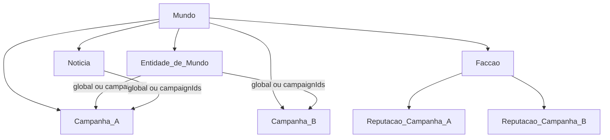

# Worldbuilding — Requisitos Técnicos de Comportamento

Documento de regras para implementação. **Sem UI, sem DDL detalhado.**  
Ancoragem: roles atuais `owner` | `editor` | `viewer` em `src/lib/store/types.ts`.

---

## 1. Glossário (ubiquitous language)

| Termo | Definição |
|-------|-----------|
| **Mundo** | Contêiner de ambientação (ex.: Faerûn). Contém várias Campanhas e o grimório compartilhado (entidades, facções, mural). |
| **Campanha** | Mesa de jogo (ex.: Mesa de Sábado). Pertence a exatamente **um** Mundo. |
| **Entidade de Mundo** | NPC, Item, Local (`GameLocation`) ou Lore que pertencem ao Mundo (não mais só à campanha). |
| **Facção** | Organização do Mundo (nome, líder, sede, objetivos). Sempre global no Mundo. |
| **Reputação de Campanha** | Status da relação Facção × Campanha (Aliado, Neutro, etc.). |
| **Notícia / Rumor** | Postagem do Mural do Mundo, com audiência global ou restrita. |
| **Thread de comentários** | Gaveta de discussão sob uma notícia; colapsada por padrão. |
| **Campanha ativa** | Campanha selecionada no cliente (`activeCampaignId`). Filtra o que o usuário vê. |
| **Membro do Mundo** | Usuário com membership (`owner` / `editor` / `viewer`) em **pelo menos uma** campanha desse Mundo. Não há membership separado de Mundo na v1. |

### Papéis (PT → código)

| Label na UI | Role | Notas |
|-------------|------|--------|
| Mestre | `owner` | Dono da campanha; pode transferir ownership e remover qualquer membro. |
| Co-mestre | `editor` | Mesmas capacidades do mestre sobre Mundo/entidades/segredos/mural/facções, **exceto** gestão do cargo do `owner`. |
| Jogador | `viewer` | Não gerencia grimório do Mundo; vê apenas o permitido pela matriz. |

---

## 2. Modelo de pertencimento



### Regras de pertencimento

1. Toda **Campanha** `belongsTo` exatamente **1 Mundo**.
2. **Entidades de Mundo** (NPC, Item, Local, Lore) pertencem ao **Mundo**, com escopo de publicação (`publicationScope` + `campaignIds` quando restrito).
3. **Personagens**, **Sessões** e **Templates de ficha** permanecem da **Campanha** (fora do escopo de migração de grimório nesta spec).
4. **Facção** pertence ao Mundo; **Reputação** é o par `(factionId, campaignId)`.
5. **Notícia** pertence ao Mundo, com audiência análoga ao escopo de entidades.
6. Acesso ao Mundo = ser membro de ≥1 campanha desse Mundo.

---

## 3. Dois eixos de visibilidade (Entidades de Mundo e Notícias)

### Eixo A — Escopo de publicação (`publicationScope`)

| Valor | Significado |
|-------|-------------|
| `global` | Visível (sujeito ao Eixo B) em **todas** as campanhas do Mundo. `campaignIds` deve ser vazio / ignorado. |
| `restricted` | Visível (sujeito ao Eixo B) **somente** nas campanhas listadas em `campaignIds[]`. |

**Validação `restricted`:**
- `campaignIds.length >= 1`
- Toda campanha em `campaignIds` deve pertencer ao **mesmo Mundo** da entidade
- UI deve permitir escolher **uma** ou **várias** campanhas

### Eixo B — Visibilidade de papel (`visibility`)

| Valor | Significado |
|-------|-------------|
| `public` | Qualquer membro da campanha ativa que passe no Eixo A vê a entidade. |
| `master_secret` | Apenas `owner` e `editor` veem. `viewer` **nunca** vê. |

### Predicados (pseudocódigo)

```
isWorldStaff(user, world) =
  exists membership where campaign.worldId = world.id
    and membership.userId = user.id
    and membership.role in { owner, editor }

isWorldMember(user, world) =
  exists membership where campaign.worldId = world.id
    and membership.userId = user.id

passesScope(entity, activeCampaign) =
  entity.worldId = activeCampaign.worldId
  AND (
    entity.publicationScope = global
    OR (
      entity.publicationScope = restricted
      AND activeCampaign.id IN entity.campaignIds
    )
  )

canViewEntity(user, entity, activeCampaign, roleInActiveCampaign) =
  // campanha ativa deve ser do mesmo mundo
  entity.worldId = activeCampaign.worldId
  AND (
    if entity.visibility = master_secret:
      // staff vê segredos mesmo fora do escopo restrito (grimório do mestre)
      isWorldStaff(user, entity.worldId)
    else: // public
      isWorldMember(user, entity.worldId)
      AND passesScope(entity, activeCampaign)
      AND roleInActiveCampaign in { owner, editor, viewer }
  )
```

**Escolha documentada — Segredo restrito:**  
`owner`/`editor` veem entidades `master_secret` **em qualquer campanha ativa do mesmo Mundo**, mesmo que `activeCampaignId ∉ campaignIds`. Isso permite gerenciar o grimório secreto sem trocar de mesa.  
`viewer` nunca vê `master_secret`, independentemente do escopo.

---

## 4. Matriz de visualização — biblioteca (NPC / Item / Local / Lore)

Contexto: usuário está na **campanha ativa** C do Mundo W.  
Entidade E pertence a W.

| publicationScope | visibility | `owner` em C | `editor` em C | `viewer` em C | Notas |
|------------------|------------|--------------|---------------|---------------|--------|
| `global` | `public` | Vê | Vê | Vê | Qualquer mesa de W |
| `global` | `master_secret` | Vê | Vê | **Não vê** | Segredo do mestre mundial |
| `restricted` (C ∈ ids) | `public` | Vê | Vê | Vê | Escopo inclui a mesa ativa |
| `restricted` (C ∈ ids) | `master_secret` | Vê | Vê | **Não vê** | Staff vê; jogador não |
| `restricted` (C ∉ ids) | `public` | **Não vê**\* | **Não vê**\* | **Não vê** | Fora do escopo público |
| `restricted` (C ∉ ids) | `master_secret` | Vê | Vê | **Não vê** | Staff ainda vê (grimório) |
| E.worldId ≠ C.worldId | * | **Não vê** | **Não vê** | **Não vê** | Outro mundo |

\*Exceção staff em linha “restrita + pública + fora do escopo”: **não vê** na biblioteca da campanha ativa (conteúdo público de outra mesa não vaza). Para editar, o staff deve abrir uma campanha que esteja em `campaignIds` **ou** a implementação pode oferecer vista “Gerenciar Mundo” no futuro; na v1, biblioteca da campanha ativa segue a tabela acima.

### Exemplos

1. **Global + Pública** — Mesa A e Mesa B (mesmo Mundo): jogadores de ambas veem o NPC na biblioteca.  
2. **Global + Segredo** — Só mestre/co-mestre veem; jogadores de qualquer mesa não.  
3. **Restrita a A+B + Pública** — Jogador na Mesa A vê; na B vê; na Mesa C (mesmo Mundo) **não** vê.  
4. **Restrita só a A + Segredo** — Mestre na Mesa B ainda vê; jogador na A **não** vê.

### Matriz resumida — Mural (Notícia / Rumor)

Mesmos eixos (`audience` ≡ `publicationScope`, mesma `visibility`).  
**Comentários herdam a visibilidade da notícia-pai:** quem não vê a notícia não vê nem a contagem útil da thread (tratar como inexistente para o viewer).

| audience | visibility | Staff (`owner`/`editor`) | Jogador (`viewer`) |
|----------|------------|--------------------------|---------------------|
| `global` | `public` | Lê / comenta\* | Lê / comenta\* |
| `global` | `master_secret` | Lê / comenta\* | Não lê |
| `restricted` (ativa ∈ ids) | `public` | Lê / comenta\* | Lê / comenta\* |
| `restricted` (ativa ∈ ids) | `master_secret` | Lê / comenta\* | Não lê |
| `restricted` (ativa ∉ ids) | `public` | Não lê na mesa ativa | Não lê |
| `restricted` (ativa ∉ ids) | `master_secret` | Lê (grimório) / comenta\* | Não lê |

\*Comentar ainda depende de `commentsLocked` (ver §7).

---

## 5. Capacidades por papel (autorização)

### 5.1 Mundo e grimório (esta spec)

| Ação | `owner` | `editor` | `viewer` |
|------|---------|----------|----------|
| Ver entidades/notícias conforme matriz §4 | Sim | Sim | Sim (só o permitido) |
| Criar / editar / excluir Entidade de Mundo | Sim | Sim | **Não** (itens próprios: §5.3) |
| Alternar `publicationScope` / `visibility` / `campaignIds` | Sim | Sim | **Não** |
| Criar / editar / excluir Facção | Sim | Sim | **Não** |
| Editar Reputação de qualquer campanha do Mundo | Sim | Sim | **Não** (só lê reputação da campanha ativa) |
| Publicar / editar / excluir Notícia; trancar comentários | Sim | Sim | **Não** |
| Comentar no mural (se vê a notícia e não trancado) | Sim | Sim | Sim |
| Deletar Mundo | **Não** (v1) | Não | Não |

Na v1 **não há exclusão de Mundo** (nem vazio): mundos só se renomeiam. Remoção futura, se existir, será decisão de produto explícita — fora deste escopo.

### 5.2 Gestão de membros da Campanha (exceção do co-mestre)

| Ação | `owner` | `editor` | `viewer` |
|------|---------|----------|----------|
| Convidar / remover `editor` e `viewer` | Sim | Sim | Não |
| Alterar role de `editor` ↔ `viewer` | Sim | Sim | Não |
| Remover o `owner` | Sim (transferência) | **Não** | Não |
| Alterar role do `owner` | Sim (transferência) | **Não** | Não |
| Transferir ownership | Sim | **Não** | Não |

### 5.3 Conteúdo próprio da Campanha (fora do grimório do Mundo)

**Estado atual do app:** `viewer` é majoritariamente leitura para grimório; **itens próprios** seguem §5.3 (criar/editar/excluir com `created_by`).

**Requisito desta spec (autorização de campanha, não flag de worldbuilding):**

Jogadores (`viewer`) **devem poder** criar, editar e excluir **conteúdo próprio da campanha**, no mínimo:
- Ficha de personagem vinculada a eles (`created_by` / ownership do personagem) — follow-up se ainda bloqueado no app
- Itens criados por eles (`created_by`) na campanha/Mundo

Sem acesso a Segredo do Mestre (`master_secret`) nem a CRUD de Entidades de Mundo / Facções / Notícias do mural.

A implementação deve tratar isso como regras de RLS/CRUD de **campanha**, separadas da matriz §4.

---

## 6. Facções e reputação

### 6.1 Facção (dados do Mundo)

Campos mínimos de comportamento:
- `worldId`
- `name`
- `leader` (texto)
- `seat` (sede, texto)
- `goals` / objetivos (texto)
- Opcionais alinhados ao protótipo: alinhamento, influência — **da facção**, não da reputação

Facção **não** usa `publicationScope`: é sempre global do Mundo. Todo membro do Mundo vê a ficha da facção.

### 6.2 Reputação

Registro: `(factionId, campaignId, status)`  
Enum:

| Código | Label PT |
|--------|----------|
| `ally` | Aliado |
| `neutral` | Neutro |
| `hostile` | Hostil |
| `unfriendly` | Antipático |

### 6.3 Regras

1. Jogadores veem/editam visualmente apenas a reputação da **campanha ativa** (edição só staff).  
2. Staff (`owner`/`editor`) pode editar reputação de **qualquer** campanha do Mundo.  
3. Ao **criar Facção**: criar reputação `neutral` para **cada** campanha existente do Mundo.  
4. Ao **criar Campanha** no Mundo: criar reputação `neutral` para **cada** facção do Mundo.  
5. Unicidade: no máximo um registro por par `(factionId, campaignId)`.

---

## 7. Mural de Notícias e Rumores

### 7.1 Campos comportamentais da Notícia

| Campo | Regra |
|-------|--------|
| `worldId` | Obrigatório |
| `audience` | `global` \| `restricted` (mesmo contrato do Eixo A) |
| `campaignIds` | Obrigatório se `restricted`; ≥1; mesmo Mundo |
| `visibility` | `public` \| `master_secret` |
| `commentsLocked` | boolean; só `owner`/`editor` alteram |
| `category` | Ex.: evento global, rumor (livre na v1) |

### 7.2 Threads / gavetas (anti-flood)

1. Lista do mural mostra notícia + **contagem** de comentários; thread **colapsada** por padrão.  
2. Conteúdo da thread carrega sob demanda ao abrir a gaveta.  
3. Profundidade máxima na v1: **1 nível de reply** (comentário raiz → respostas). Sem nest infinito.  
4. Quem não pode ver a notícia não recebe contagem nem payload da thread.

### 7.3 Quem lê e quem comenta

**Ler:** matriz §4 (Mural).

**Comentar** — todas as condições:
1. `canView` a notícia (matriz)  
2. É membro do Mundo  
3. Se `commentsLocked = true` → apenas `owner`/`editor`; `viewer` não comenta  

### 7.4 Autoria e moderação

- Autor pode editar/excluir o **próprio** comentário.  
- Staff (`owner`/`editor`) pode excluir **qualquer** comentário da notícia.  
- Trancar comentários não apaga thread existente; apenas bloqueia novos de jogadores (staff ainda pode, se a regra de locked permitir só staff — sim: locked = só staff comenta).

---

## 8. Regras de exclusão (cascata e validações)

| Ação | Efeito obrigatório |
|------|-------------------|
| **Deletar Campanha** | 1) Cascade atual do DB para memberships, invites, personagens, sessões, activity, etc. da campanha. 2) Apagar todas as **reputações** com esse `campaignId`. 3) Em entidades/notícias `restricted`, remover esse id de `campaignIds`. 4) Se `campaignIds` ficar **vazio**: converter para `publicationScope/audience = global` e **manter** `visibility` (não apagar o conteúdo). |
| **Deletar Facção** | Apagar todas as reputações `(factionId, *)`. NPCs com campo texto `faction` legado: **não** apagar NPC; texto fica órfão até migração futura para FK. |
| **Deletar Entidade de Mundo** | Sem cascade em `entityLinks` (refs quebram como hoje). |
| **Deletar Mundo** | **Não permitido na v1** (UI, action e erro inexistentes). Mundos permanecem; só renomeação. |
| **Deletar Notícia** | Apagar em cascata todos os comentários/threads filhos. |
| **Deletar Comentário** | **Hard delete** + cascata nos filhos (replies) daquele nó. |

### Validações de exclusão (rejeitar com erro claro)

- Qualquer tentativa de deletar Mundo → fora de escopo / não implementado na v1.  
- `editor` tentar remover/`demote` o `owner` → erro `CANNOT_MODIFY_OWNER`.  
- `viewer` tentar CRUD de grimório/facção/notícia → erro `FORBIDDEN` (itens próprios: ver §5.3).  
- `restricted` com `campaignIds` de outro Mundo → erro de validação na escrita (não só na exclusão).

---

## 9. Mundo padrão e criação de campanha

### 9.1 Algoritmo (nova campanha)

1. Usuário cria campanha.  
2. Se informar `worldId` válido (Mundo do qual é staff ou membro elegível): associar.  
3. Se **não** informar `worldId`:  
   - Se o `owner` da nova campanha **já possui** um Mundo marcado como padrão (`isDefault` / nome “Mundo Padrão”): reutilizar.  
   - Senão: criar Mundo `{ name: "Mundo Padrão", isDefault: true, ownerUserId: owner.id }` e associar.  
4. Após criar a campanha: para cada Facção do Mundo, criar reputação `neutral` (ver §6.3).

### 9.2 Retrocompatibilidade (migração de dados)

Ver §10.

---

## 10. Migração retrocompatível

Objetivo: campanhas e entidades atuais continuam usáveis sem ação do usuário.

### 10.1 Mundos e campanhas legadas

1. Agrupar campanhas existentes por `ownerId`.  
2. Para cada owner com ≥1 campanha: criar **um** Mundo Padrão (`isDefault: true`).  
3. Associar **todas** as campanhas desse owner a esse Mundo.

> Nota: se no futuro campanhas do mesmo owner precisarem de mundos distintos, a UI permitirá mover campanha entre Mundos; a migração inicial é 1 Mundo Padrão por owner.

### 10.2 Entidades legadas (NPC, Item, Local, Lore)

Hoje vivem em `campaign_id`. Após migração:

| Campo novo | Valor na migração |
|------------|-------------------|
| `worldId` | Mundo da campanha original |
| `publicationScope` | `restricted` |
| `campaignIds` | `[campaignIdOriginal]` |
| `visibility` | `public` |

**Exceção Lore:** se `isSecret === true` (ou coluna `is_secret`), migrar `visibility = master_secret` e manter/deprecar `isSecret` como espelho até remoção.

### 10.3 Imagens privadas

`ImageAsset.isPrivate` permanece regra própria de mídia na v1 (não unificar automaticamente com `master_secret` de entidades). Documentar follow-up se quiser alinhar.

### 10.4 Facções

Não existem facções persistidas hoje (apenas string em NPC). Migração de facções: **não criar** facções a partir do texto. Follow-up: FK `factionId` em NPC.

---

## 11. Fora de escopo (v1 deste documento)

- Wireframes / componentes de UI  
- Schema SQL completo e políticas RLS literais (implementação deve derivar das regras acima)  
- Migração `Npc.faction` (string) → FK para Facção  
- Vista global “Gerenciar Mundo” fora da campanha ativa  
- Notificações push de novas postagens do mural  

---

## 12. Checklist de aceite para a IA de implementação

- [ ] Campanha nova sem `worldId` cai no Mundo Padrão do owner (cria se necessário).  
- [ ] Matriz §4 respeitada na listagem (biblioteca + mural) com campanha ativa.  
- [ ] `editor` gerencia grimório/segredos como `owner`, mas não altera o `owner`.  
- [ ] `restricted` aceita 1..N campanhas do mesmo Mundo.  
- [ ] Deletar campanha promove entidades órfãs restritas → `global` (mantém `visibility`).  
- [ ] Deletar facção remove reputações; não apaga NPCs.  
- [ ] Mundo **não** é deletável na v1 (doc e produto alinhados).  
- [ ] Comentários: gaveta colapsada, 1 nível de reply, `commentsLocked` bloqueia viewers.  
- [ ] Migração: entidades antigas = restritas à campanha original; lore secreta = `master_secret`.  
- [ ] Viewers não CRUD grimório do Mundo; **podem** criar/editar/excluir itens próprios (`created_by`).
